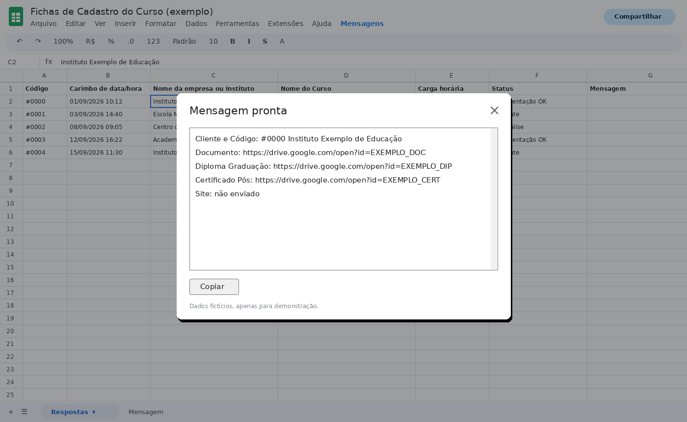

# automatizador-mensagens-sheets

Apps Script para buscar clientes e a documentação enviada numa planilha de formulário e gerar uma mensagem pronta.

## Problema
Conferir a documentação de cada cliente exigia buscar manualmente várias colunas da planilha.

## Solução
Um menu no Google Sheets que busca pelo nome do cliente ou do curso e devolve uma mensagem pronta para copiar, numa janela pop-up.

## Como usar
1. Na planilha, abra **Extensões > Apps Script**.
2. Cole o código de `codigo.gs` e ajuste `NOME_DA_ABA` para o nome da aba de respostas.
3. Salve e recarregue a planilha.
4. Use o menu **Mensagens > Buscar cliente ou curso**.

## Tecnologias
- Google Apps Script (JavaScript)
- Google Sheets / Google Forms
